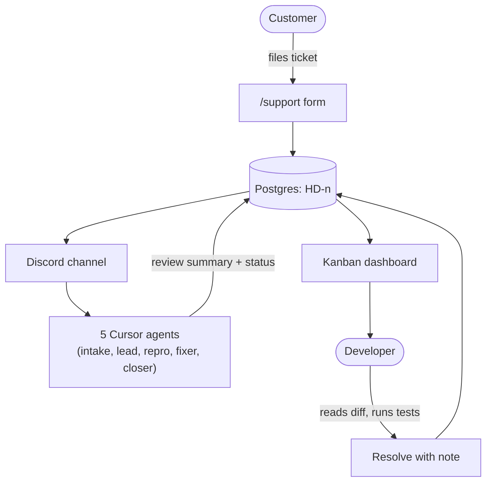
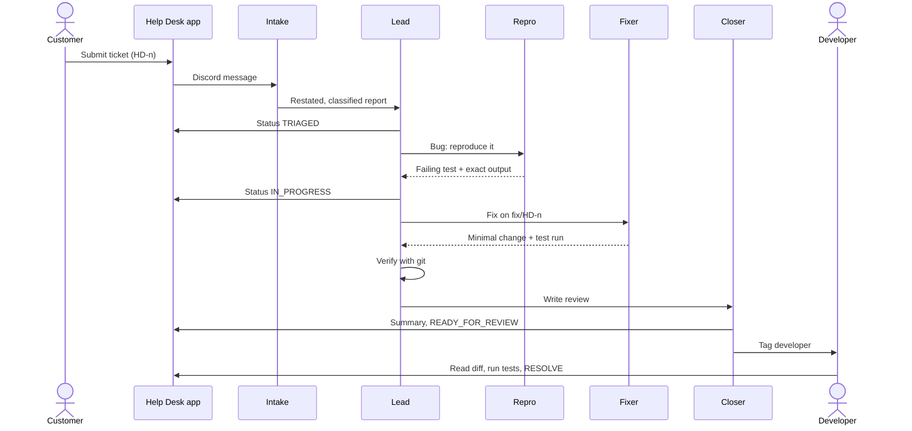
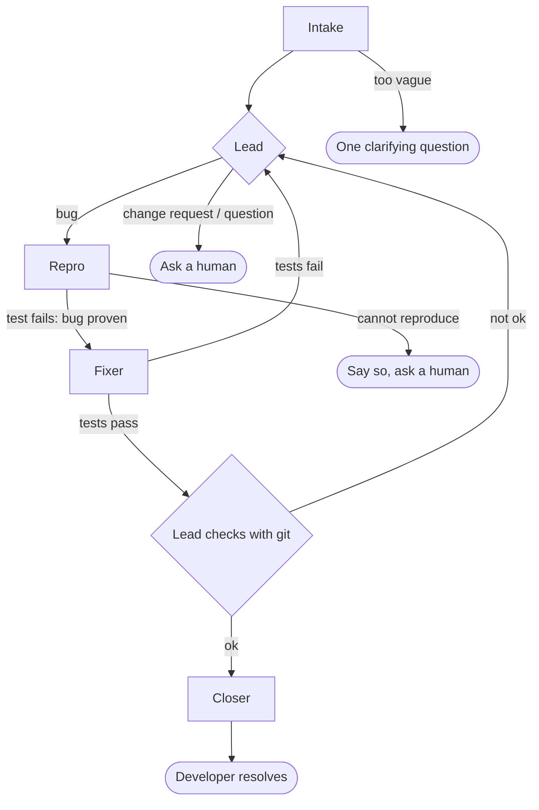
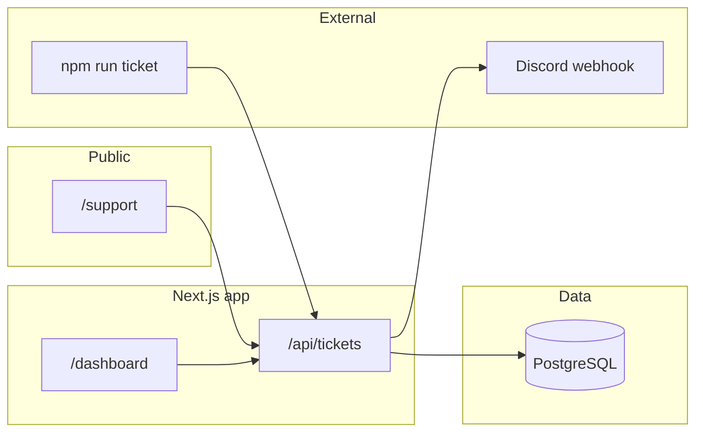

# Help Desk

**Frontdesk: a help desk where a team of AI agents does the first hour of bug work, inside your Discord room, and a developer approves the result.**

Customers file tickets on a support form. Five Cursor agents in Discord restate the report, reproduce the bug with a failing test, make the smallest fix on a local branch, and write a review summary. A developer reads the diff, runs the tests and resolves the ticket on the dashboard. **Only a signed-in developer can mark a ticket Resolved.**

Tickets are numbered **HD-1**, **HD-2**, and so on.

## The problem

When a customer hits a bug, support passes a vague report to engineering, and a developer spends the first hour just reproducing it. Many reports stall because nobody can reproduce them.

This is for **small product teams** whose support staff can't read code and whose developers are pulled out of their work by every escalation.

## What it does



1. A customer files a ticket on the support form. It's stored in Postgres with a number like HD-12 and appears on the Kanban dashboard.
2. The same ticket is posted into the team's Discord channel, where five Cursor agents pick it up in turn.
3. The developer reads the diff, runs the tests, and resolves the ticket in the dashboard. The ticket keeps the agents' review and the developer's note.

## Meet the agents

| Agent | Job |
|-------|-----|
| **Intake** | Reads the customer's plain-language report, restates it, classifies it as a bug, change request or question, and asks one clarifying question if the report is too vague |
| **Lead** | Coordinates. Updates the ticket status, sends bugs to repro, decides what happens when a step fails, and checks the fixer's work with git before anything reaches the developer |
| **Repro** | Writes a new failing test that proves the bug, runs it, and reports the exact output |
| **Fixer** | Makes the smallest application-code change on a local branch (`fix/HD-n`) and runs the tests |
| **Closer** | Writes a review summary (files changed, diff, test result, risk) onto the ticket and tags the developer |



If a bug can't be reproduced, the agents say so and ask a human. The lead doesn't send it on to the fixer.



## Guardrails

- Agents never push or merge code.
- Risky commands need the developer's approval in the chat ("Permission needed" prompts).
- Only the intake agent accepts messages from anyone. The others accept only the owner and the owner's agents.
- If a bug can't be reproduced, agents say so and ask a human instead of guessing.
- Agents also can't set a ticket to RESOLVED. The server rejects it with a 403.

## What is simulated

Frontdesk runs locally by design, because the agents work on a local checkout of the code, like a developer would.

- The "customer" sites are three small demo apps (`src/dummy-sites/`), each with one planted bug.
- A ticket form stands in for a real support channel.
- The agents share one working folder, so tickets are handled one at a time.

## Stack

Next.js, Postgres with Prisma, Jest, Discord, Switch Console, Cursor CLI agents.

## Features

- Public bug report form for three fictional product sites
- Five-column developer kanban board behind a password
- Discord webhook with role mention, assignee mention and sanitized descriptions
- Agent CLI (`npm run ticket`) and HTTP API with separate permissions
- Separate fields for the agent's review (`resolutionSummary`) and the developer's note (`resolutionNote`)
- Rate-limited public submissions (5 per minute per IP)
- Signed admin cookie, so sessions survive dev-server restarts
- Optional [Switch](https://switch.dev) agent pipeline templates under `switch/`
- Demo "product" code with Jest tests for agents to fix in separate branches

## Surfaces

| Surface | Who | Purpose |
|---------|-----|---------|
| [`/`](http://localhost:3000/) | Anyone | Landing page with links to report a bug or open the board |
| [`/support`](http://localhost:3000/support) | Public | Submit a ticket (project and description) |
| [`/dashboard`](http://localhost:3000/dashboard) | Developer (password) | Five-column board: move tickets, resolve with an optional note |
| Discord webhook | Team and agents | New-ticket notifications with a role mention |
| `npm run ticket` | Agent (API key) | Update status and attach a review summary from the CLI |

## Architecture



## Ticket workflow

Statuses, in board order:

1. **OPEN**: new report
2. **TRIAGED**
3. **IN_PROGRESS**
4. **READY_FOR_REVIEW**: an agent review summary may be attached
5. **RESOLVED**: developer-only, with an optional developer note and `resolvedAt`

| Actor | Auth | Can do |
|-------|------|--------|
| Public | None | Create tickets (rate limited) |
| Agent | `Authorization: Bearer AGENT_API_KEY` | Set any status **except RESOLVED**; set `resolutionSummary` |
| Developer | Admin session cookie | Move tickets anywhere, including RESOLVED; set `resolutionNote` |

Resolving sets `resolutionNote` and `resolvedAt` and never overwrites `resolutionSummary`. Reopening only changes status and leaves the summary and note as they are.

### Ticket data model

| Field | Notes |
|-------|-------|
| `id` | cuid (internal) |
| `number` | Auto-increment; shown as `HD-<number>` |
| `project` | `Site 1`, `Site 2` or `Site 3` |
| `description` | Up to 4000 characters |
| `status` | One of the five statuses above |
| `resolutionSummary` | Agent review text (up to 4000 characters) |
| `resolutionNote` | Developer note (up to 4000 characters) |
| `resolvedAt` | Set when resolved |
| `createdAt` / `updatedAt` | Timestamps |

## Fictional product sites

Bug reports are filed against **Site 1**, **Site 2** or **Site 3**. Reference implementations and Jest checks live under `src/dummy-sites/`:

| Site | Module | Domain |
|------|--------|--------|
| Site 1 | `site1-checkout.ts` | Checkout referral codes (`SAVE10`, `WELCOME5`) |
| Site 2 | `site2-auth.ts` | Sign-in email validation |
| Site 3 | `site3-cart.ts` | Cart total with discounts |

These modules aren't wired to UI routes. They're demo products that agents can fix in separate branches.

## Requirements

- **Node.js** 20+ (LTS recommended)
- **npm**
- **Docker** (for local Postgres) or your own PostgreSQL instance
- Optional: a Discord server with an incoming webhook

## Quick start

```bash
docker compose up -d          # start Postgres
cp .env.example .env.local    # PowerShell: copy .env.example .env.local
npm install                   # also runs prisma generate
npx prisma migrate dev        # create tables
npm run dev                   # http://localhost:3000
```

Details:

1. **Database**: Postgres listens on `localhost:5432` with user, password and database `postgres` / `postgres` / `helpdesk` (see `docker-compose.yml`).
2. **Environment**: edit `.env.local`. Never commit it.
3. **Prisma**: after any schema change, run `npx prisma generate` and **restart** `npm run dev` so the server loads the new client.
4. **Port**: use another port if needed, e.g. `npm run dev -- -p 3001`.

## Environment variables

| Variable | Required | Description |
|----------|----------|-------------|
| `DATABASE_URL` | Yes | PostgreSQL connection string |
| `DISCORD_WEBHOOK_URL` | For Discord | Incoming webhook URL. If unset, tickets are still created but nothing is posted |
| `DISCORD_BOT_ROLE_ID` | For role ping | Numeric Discord role id |
| `DISCORD_ENTRY_AGENT` | No | Suffix after the role mention (default `lead`) |
| `AGENT_API_KEY` | For agents and CLI | Secret for `Authorization: Bearer …` |
| `ADMIN_PASSWORD` | For dashboard | Login password. If empty, all logins are rejected |
| `PROJECT_OWNERS` | No | JSON map such as `{"Site 1":"<discordUserId>"}` |
| `HELPDESK_URL` | No | Base URL for `npm run ticket` (default `http://localhost:3000`) |

> The values in `.env.example` (such as `AGENT_API_KEY` and `ADMIN_PASSWORD`) are placeholders for local use. **Change them before deploying anywhere.**

Generate a strong key:

```bash
node -e "console.log(require('crypto').randomBytes(32).toString('hex'))"
```

## Using the dashboard

1. Set `ADMIN_PASSWORD` in `.env.local` and restart the dev server.
2. Open **/dashboard** and log in.
3. Use the column actions to advance tickets.
4. **Mark resolved** opens an optional developer note. Confirm to set **RESOLVED**.
5. **Show agent review** on a card expands the agent's `resolutionSummary`, if there is one.

## Agent CLI

Run it from the project root. It reads `.env.local` for `AGENT_API_KEY` and the optional `HELPDESK_URL`.

```bash
npm run ticket -- HD-4 TRIAGED
npm run ticket -- HD-4 READY_FOR_REVIEW --summary-file ./review.txt
```

- The ticket reference is `HD-<number>` or the internal ticket id.
- Status must be one of `OPEN`, `TRIAGED`, `IN_PROGRESS`, `READY_FOR_REVIEW`, `RESOLVED`.
- `RESOLVED` is rejected with **403** for the agent key. Use the dashboard to resolve.
- `--summary-file` sets `resolutionSummary` only (not the developer note).

## HTTP API

| Method | Path | Auth | Notes |
|--------|------|------|-------|
| `POST` | `/api/tickets` | Public (rate limited) | Create a ticket |
| `GET` | `/api/tickets` | Admin session or agent Bearer | List tickets |
| `PATCH` | `/api/tickets/:id` | Admin session or agent Bearer | Update status or summary; see actor rules above |
| `POST` | `/api/admin/login` | Body `{ "password": "…" }` | Sets the admin cookie |

The `:id` can be `HD-12` or the internal cuid.

Example:

```bash
curl -X POST http://localhost:3000/api/tickets \
  -H "Content-Type: application/json" \
  -d '{"project":"Site 1","description":"SAVE10 is rejected at checkout"}'

curl -X PATCH http://localhost:3000/api/tickets/HD-1 \
  -H "Authorization: Bearer $AGENT_API_KEY" \
  -H "Content-Type: application/json" \
  -d '{"status":"TRIAGED"}'
```

## Discord notifications

When a ticket is created, the webhook sends:

```text
<@&ROLE_ID>-{entryAgent}
HD-12
Site 1
(description lines…)
Assigned: <@userId>   ← only if PROJECT_OWNERS maps this project
```

- `DISCORD_BOT_ROLE_ID` is the role snowflake for the mention.
- `DISCORD_ENTRY_AGENT` is the suffix after the mention (default `lead`), for Switch-style agent routing.
- `PROJECT_OWNERS` maps project names to Discord user ids for assignee mentions.

Descriptions are sanitized (mentions stripped) before posting.

## Switch / agent pipeline (optional)

The `switch/` directory holds a **frontdesk-pipeline** template and agent definitions for [Switch](https://switch.dev)-style rooms:

| Agent | File |
|-------|------|
| Intake | `switch/agents/frontdesk-intake.md` |
| Lead | `switch/agents/frontdesk-lead.md` |
| Repro | `switch/agents/frontdesk-repro.md` |
| Fixer | `switch/agents/frontdesk-fixer.md` |
| Closer | `switch/agents/frontdesk-closer.md` |

See `switch/SETUP-DISCORD.md` for aligning Discord role names with the `<@&ROLE_ID>-{entryAgent}` mentions this app sends. Set `DISCORD_ENTRY_AGENT` to match your intake agent suffix (e.g. `intake` or `lead`).

## Project layout

```text
prisma/              Schema and migrations
scripts/
  ticket-status.mjs  Agent status CLI
src/
  app/               Next.js App Router (pages and API routes)
    api/             tickets and admin/login routes
    dashboard/       Kanban board and login
    support/         Public report form
  components/        Shared UI
  dummy-sites/       Site 1–3 reference code and tests
  generated/prisma/  Generated Prisma client (do not edit)
  lib/               Admin auth, Discord, Prisma, rate limit, ticket helpers
switch/              Optional Switch pipeline template and docs
docker-compose.yml   Local Postgres
```

## Scripts

| Command | Description |
|---------|-------------|
| `npm run dev` | Development server |
| `npm run build` | `prisma generate` and production build |
| `npm run start` | Run the production server |
| `npm run lint` | ESLint |
| `npm test` | Jest (`src/dummy-sites` and API route tests) |
| `npm run ticket` | Agent ticket status CLI |
| `npm run db:migrate` | `prisma migrate dev` |
| `npm run db:generate` | `prisma generate` |

## Testing

```bash
npm test
npm run lint
```

Jest covers the dummy-site behavior and the PATCH authorization rules in `src/app/api/tickets/[id]/route.test.ts`.

## Deployment notes

- Run `npx prisma migrate deploy` against the production database, then `npm run build` and `npm run start`.
- Set all environment variables in your host's secret store. Use a strong `AGENT_API_KEY` and `ADMIN_PASSWORD`.
- The rate limiter is in-memory per process. Use a shared store if you run multiple instances.
- Keep Postgres private and serve the app over HTTPS.

## Troubleshooting

| Problem | Fix |
|---------|-----|
| Prisma errors after a schema change | `npx prisma generate`, apply migrations, restart `npm run dev` |
| Can't connect to the database | Check `docker compose ps` and `DATABASE_URL` |
| Dashboard login always fails | `ADMIN_PASSWORD` is empty or the server wasn't restarted |
| CLI returns 401 | `AGENT_API_KEY` is missing or doesn't match the server |
| CLI returns 403 | Agents can't set RESOLVED. Resolve it from the dashboard |
| No Discord message | Check `DISCORD_WEBHOOK_URL`. The ticket is still saved either way |
| 429 on `/api/tickets` | Rate limit hit (5 per minute per IP). Wait and retry |

## Development guardrails

- Keep secrets in `.env.local` only. Commit `.env.example` with placeholders, not real keys or webhooks.
- After schema or Prisma client changes: `npx prisma generate`, apply migrations, restart the dev server.

## Tech stack details

- **Next.js 16** (App Router, React 19)
- **Prisma 7** and **PostgreSQL** (`@prisma/adapter-pg`)
- **Tailwind CSS 4**
- **Jest** and **TypeScript**
- **Docker Compose** for local Postgres
# help-desk

