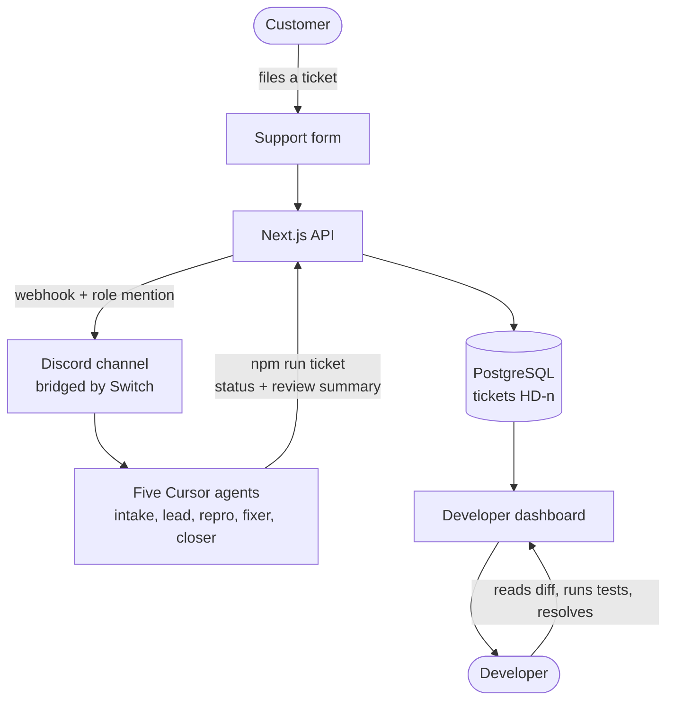
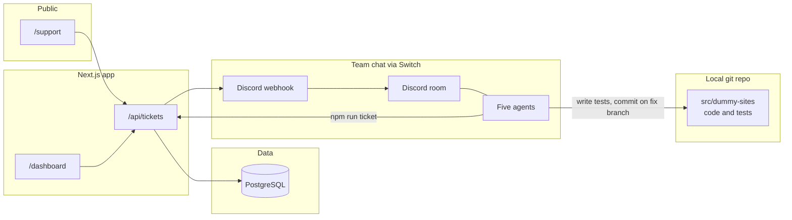
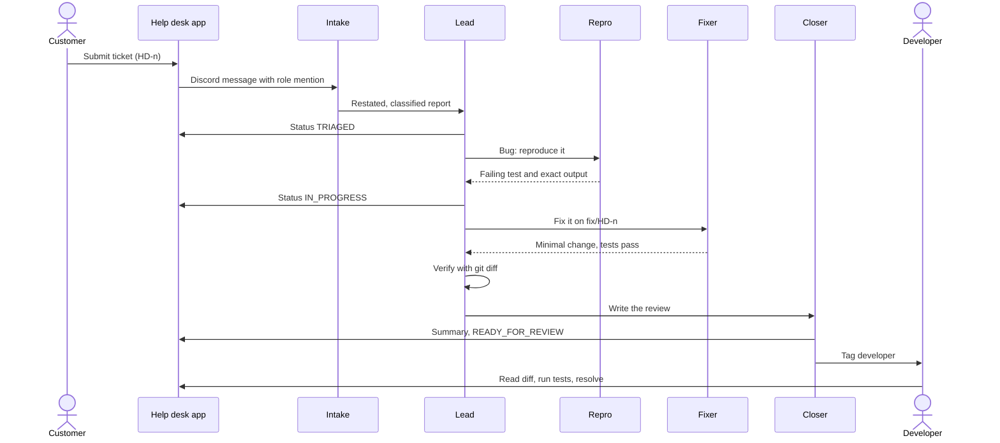
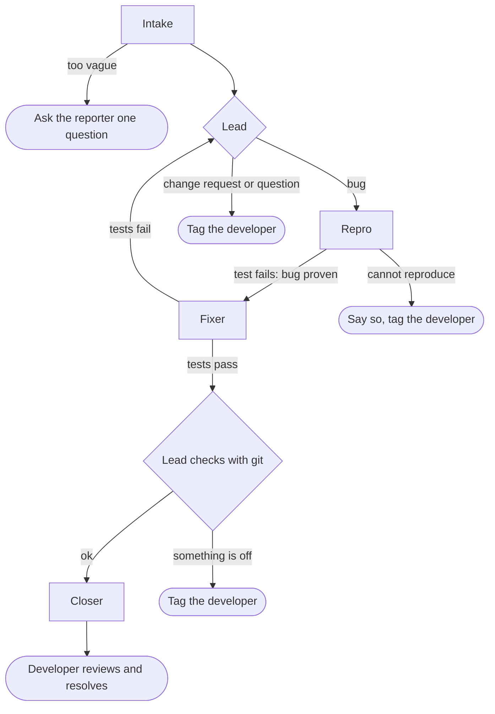
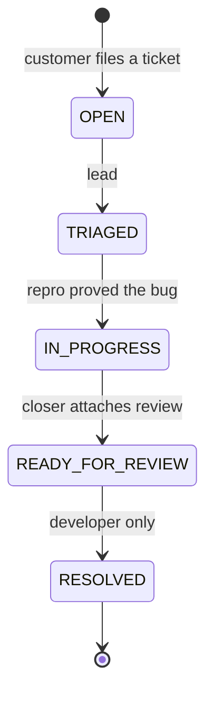

# Frontdesk

**A help desk where a team of AI agents does the first hour of bug work inside your Discord room, and a developer approves the result.**

A customer files a ticket on a support form. Five [Cursor](https://cursor.com) agents, connected to Discord with [Switch](https://github.com/sandbox-quantum/switch), restate the report, prove the bug with a failing test, make the smallest fix on a local branch and write a review summary. A developer reads the diff, runs the tests and resolves the ticket on the dashboard.

> **Only a signed-in developer can mark a ticket Resolved.** Agents never push or merge code.

**Demo video:** [ADD LINK] (under 3 minutes)  
**Built for:** the [Flip the Switch Hackathon](https://www.wemakedevs.org/hackathons/switch), Track 1 (Best Business Workflow). Built solo with Cursor and Switch.

---

## Contents

1. [The problem](#the-problem)
2. [How it works](#how-it-works)
3. [How Switch is used](#how-switch-is-used)
4. [Meet the agents](#meet-the-agents)
5. [One ticket, step by step](#one-ticket-step-by-step)
6. [Guardrails](#guardrails)
7. [Quick start](#quick-start)
8. [Run the full pipeline (Switch + Discord)](#run-the-full-pipeline-switch--discord)
9. [Reset between runs](#reset-between-runs)
10. [Reference: dashboard, CLI, API, data](#reference)
11. [From demo to production](#from-demo-to-production)
12. [Known limits](#known-limits)
13. [Troubleshooting](#troubleshooting)
14. [Project layout and stack](#project-layout-and-stack)

---

## The problem

When a customer hits a bug, support passes a vague report to engineering, and a developer spends the first hour just reproducing it. Many reports stall because nobody can reproduce them.

Frontdesk is for **small product teams** whose support staff can't read code and whose developers are pulled out of their work by every escalation. The agents do the slow, repetitive part (understand the report, reproduce it, draft a fix) in the open, where the team can watch. The developer keeps the decision.

## How it works



1. A customer files a ticket on `/support`. It is stored in Postgres with a number like **HD-12** and appears on the Kanban dashboard.
2. The same ticket is posted into the team's Discord channel. A role mention wakes the intake agent.
3. Five agents hand the ticket to each other by name, in visible threads. Each one reports its result back to the **lead**, who decides what happens next.
4. The lead and closer update the ticket through a small authenticated API, so the dashboard always matches the chat.
5. The developer reviews the agents' diff and summary, runs the tests and resolves the ticket. The ticket keeps both the agents' review and the developer's note.

### Components



## How Switch is used

[Switch](https://github.com/sandbox-quantum/switch) is the layer that puts agents into team chat. Without it, this project would be five agents in five terminals on one laptop that can't see each other or the people.

| Question | Answer |
|---|---|
| **Which agents are connected?** | Five Cursor CLI agents: `frontdesk-intake`, `frontdesk-lead`, `frontdesk-repro`, `frontdesk-fixer`, `frontdesk-closer`. They run locally through Switch Console and share one working folder (this repo). |
| **Which platform?** | Discord. One channel (`#frontdesk-triage`) is bridged through a Discord bot connection in Switch. |
| **How does a ticket reach the agents?** | The app posts a webhook message into the channel that starts with a role mention, `<@&ROLE_ID>-intake`. Switch maps that to the intake agent. |
| **Who can talk to which agent?** | Intake accepts anyone, because the website's webhook is not a Switch user. The other four accept only the owner and the owner's agents. A ticket reaching the lead directly is refused by design. |
| **How do people work with it?** | The reporter only touches the support form. The developer works in the Discord room: sees every step, approves risky commands in the *Permission needed* prompts, reviews the diff and resolves the ticket on the dashboard. |
| **What does Switch give us?** | One shared room with people, addressing rules, history, visible hand-offs, *View activity* and *Stop current work* controls, and approvals in the same thread. |

The agents' instructions live in [`switch/agents/`](switch/agents), with a template and a Discord setup guide in [`switch/`](switch).

## Meet the agents

| Agent | Who can talk to it | Job |
|---|---|---|
| **Intake** | Anyone | Reads the plain-language report, restates it, classifies it as a bug, change request or question, and asks one clarifying question if the report is too vague. Hands clear bugs to the lead. Runs no commands and edits no files. |
| **Lead** | Owner and agents | Coordinates. Marks the ticket `TRIAGED` and `IN_PROGRESS`, sends bugs to repro, decides what happens when a step fails, and checks the fixer's work with git before anything reaches the developer. Never edits code, never sets `RESOLVED`. |
| **Repro** | Owner and agents | Writes a **new** failing test (`src/dummy-sites/<file>.HD-n.test.ts`) that proves the bug, runs it and reports the exact output. Never fixes the bug and never edits existing tests. |
| **Fixer** | Owner and agents | Creates `fix/HD-n`, makes the smallest application-code change, runs the tests and commits locally. Never edits tests, never pushes or merges. |
| **Closer** | Owner and agents | Writes the review summary (files changed, diff, test result, risk), attaches it to the ticket as `READY_FOR_REVIEW` and tags the developer. Never sets `RESOLVED`. |

The exact instructions are in [`switch/agents/`](switch/agents). They describe design intent: the agents are language-model driven, so always review what they did.

### Hand-offs



### When something goes wrong

The agents are designed to stop and ask a human rather than guess.



## One ticket, step by step

Using the planted bug in **Site 1**: referral codes are case-sensitive, so `save10` is rejected while `SAVE10` works. The existing tests don't cover it, so they pass.

1. **The report.** A customer writes, in plain language: *"I got a referral code in an email, 'save10', and typed it at checkout. It says 'Invalid code'. My friend used the same code yesterday and got 10% off."*
2. **Intake** restates it, classifies it as a bug and hands it to the lead in one structured line (ticket, project, type, steps, expected, actual).
3. **Lead** marks `HD-n` as `TRIAGED` and sends it to repro.
4. **Repro** writes a failing test, runs it, and posts `Reproduced: yes`, the test file, the command and the failing output. The lead marks the ticket `IN_PROGRESS`.
5. **Fixer** makes the smallest change on `fix/HD-n` and runs `npm test`.
6. **Lead** runs `git diff --name-only` on the branch to check that only application code changed and no existing test was edited.
7. **Closer** writes the review summary and sets `READY_FOR_REVIEW`.
8. **You**, the developer:
   ```bash
   git diff --stat main..fix/HD-n
   git diff main..fix/HD-n
   git checkout fix/HD-n && npm test      # passes on the branch
   git checkout main && npm test          # the new test fails here: the bug was real
   ```
   Then click **Mark resolved** on the dashboard and add a note.

If a report is too vague, repro answers `Reproduced: no`, and the lead tags you instead of sending it to the fixer.

## Guardrails

Several layers, none of which relies on the agents behaving perfectly:

| Layer | What it does |
|---|---|
| **Addressing** | Only the intake agent accepts anyone. The other four accept only the owner and the owner's agents. |
| **Permission prompts** | Bypass is off. Risky commands appear as *Permission needed* in Discord and run only when the developer allows them. |
| **No push, no merge** | Agents commit only to a local `fix/HD-n` branch. The developer decides what gets published. |
| **Server-side rule** | The agent API key can set every status **except `RESOLVED`**. The server rejects it with a 403. Only a signed-in developer resolves tickets. |
| **Lead verification** | The lead checks the fixer's changed files with git instead of trusting its report. |
| **Input hygiene** | Public submissions are rate limited (5 per minute per IP). Descriptions are sanitized (mentions stripped) before they are posted to Discord. |
| **Separate records** | The agents' review (`resolutionSummary`) and the developer's note (`resolutionNote`) are separate fields, and resolving never overwrites the agents' review. |

**Optional hardening:** Cursor CLI supports project-level permission rules in `.cursor/cli.json` (allow and deny lists for shell commands and file reads and writes). Deny `git push`, installs and reading `.env*` if you want enforcement beyond the agents' instructions, and test the rules before relying on them.

**Be honest about the limits.** Customer text is untrusted input that agents read. The protections above reduce the risk, but the developer's review of the diff and the test file is the final check.

---

## Quick start

This path runs the app, dashboard, API and tests with **no Discord and no Switch**, so you can check the code in a few minutes.

### Requirements

- **Node.js** 20+ (LTS recommended) and **npm**
- **Docker** (for local Postgres) or your own PostgreSQL instance

### Run it

```bash
git clone <YOUR-REPO-URL> help-desk
cd help-desk
docker compose up -d                # start Postgres
cp .env.example .env.local          # PowerShell: copy .env.example .env.local
npm install                         # also runs prisma generate
npx prisma migrate dev              # create tables
npm run dev                         # http://localhost:3000
```

Then edit `.env.local`: set `ADMIN_PASSWORD` and `AGENT_API_KEY` (generate a key with `node -e "console.log(require('crypto').randomBytes(32).toString('hex'))"`) and restart `npm run dev`.

Postgres listens on `localhost:5432` with user, password and database `postgres` / `postgres` / `helpdesk` (see `docker-compose.yml`). If port 3000 is busy, use `npm run dev -- -p 3001` and set `HELPDESK_URL=http://localhost:3001` in `.env.local`.

### Try it without agents

1. Open `/support`, choose **Site 1**, describe a bug and submit. You get a ticket number like `HD-1`.
2. Open `/dashboard` and log in with `ADMIN_PASSWORD`. The ticket is in **Open**.
3. Act as an agent from the terminal:
   ```bash
   npm run ticket -- HD-1 TRIAGED
   npm run ticket -- HD-1 READY_FOR_REVIEW --summary-file ./review.txt
   ```
   Trying `RESOLVED` with the agent key returns a 403 by design.
4. Back on the dashboard, expand **Show agent review**, then **Mark resolved** with a note.
5. `npm test` runs the Jest suite (dummy-site behavior and the API's authorization rules).

---

## Run the full pipeline (Switch + Discord)

You need Docker, Node, [Switch Console](https://github.com/sandbox-quantum/switch), a Discord server you control, and a Cursor account (the agents use the Cursor CLI).

### 1. Discord bot and connection

1. In the [Discord developer portal](https://discord.com/developers/applications), create an application and a bot. Copy the bot token (keep it private).
2. Under **Bot**, turn on **Message Content Intent**. If Switch can't list members, also turn on **Server Members Intent**.
3. Invite the bot to your server with at least: View Channels, Send Messages, Read Message History, Embed Links, Attach Files, Add Reactions, Create Public Threads and Send Messages in Threads.
4. In Switch Console, open **Connectors**, add **Discord** and enter the bot token and your server (guild) ID. Turn on Discord **Developer Mode** to copy the server ID.
5. In Console, link your own Discord account (**Home**, then *Link my account*), so agents recognize you as the owner.

### 2. Cursor CLI

```bash
# Windows PowerShell
irm 'https://cursor.com/install?win32=true' | iex
cursor-agent login
cursor-agent status
```

Then restart Console, open **Agent providers** and press **Recheck**. Cursor should show as signed in.

### 3. Agents and room

Create the five agents and one room (`frontdesk-triage`) bridged to your Discord connection. Use the template under [`switch/`](switch) (**Templates, Import template, Use**), or recreate the agents from the instruction files in [`switch/agents/`](switch/agents).

- **Team name:** `frontdesk`. The Discord role in step 4 must match it.
- **Provider:** Cursor.
- **Working folder (directory):** the path of **this repo clone**. The same path for all five agents.
- **Addressing:** intake = anyone; the other four = owner and agents.
- Keep **bypass off**.

### 4. Role and webhook (how the website wakes the agents)

1. In your Discord server, create a role named exactly **`Frontdesk`** (the team name). In Switch's Discord mapping, `@Frontdesk-intake` is the role mention plus the agent suffix.
2. Copy the role ID: with Developer Mode on, right-click the role, **Copy Role ID**. A reliable check: send `\@Frontdesk` in a channel and read the number after `<@&`.
3. In the channel's settings, **Integrations, Webhooks**, create a webhook and copy its URL (keep it private).
4. Put them in `.env.local`:

```ini
DISCORD_WEBHOOK_URL=...
DISCORD_BOT_ROLE_ID=...
DISCORD_ENTRY_AGENT=intake
```

Restart `npm run dev` after every `.env.local` change. A fuller walkthrough is in [`switch/SETUP-DISCORD.md`](switch/SETUP-DISCORD.md).

### 5. Submit a ticket

Open `/support`, pick **Site 1** and file the report from [One ticket, step by step](#one-ticket-step-by-step). In Discord you should see a blue **@Frontdesk-intake** mention, then the intake agent replying and handing off to the lead. Approve each *Permission needed* prompt after reading the command. Reject anything touching `.env.local`, installs, or `git push`.

### 6. Review

Follow step 8 of [One ticket, step by step](#one-ticket-step-by-step), then resolve the ticket on the dashboard.

## Reset between runs

All agents share one working folder, so a finished run leaves the repo on `fix/HD-n` with the bug already fixed. Handle **one ticket at a time** and reset before the next one:

```bash
git checkout main
git branch                           # list the fix branches
git branch -D fix/HD-12              # repeat for each fix/HD-* branch
git status                           # should be clean on main
```

Delete any leftover `src/dummy-sites/*.HD-*.test.ts` files on `main`. To mark a known-good starting point once and return to it later:

```bash
git tag demo-start
git reset --hard demo-start          # discards uncommitted changes
```

Check that the Site 1 bug is planted: `site1-checkout.ts` should not lowercase or uppercase the referral code before the lookup. If a run answers `Reproduced: no` for the `save10` report, a previous fix is still checked out.

---

## Reference

### Surfaces

| Surface | Who | Purpose |
|---|---|---|
| [`/`](http://localhost:3000/) | Anyone | Landing page with links to report a bug or open the board |
| [`/support`](http://localhost:3000/support) | Public | Submit a ticket (project and description) |
| [`/dashboard`](http://localhost:3000/dashboard) | Developer (password) | Kanban board: move tickets, resolve with an optional note |
| Discord webhook | Team and agents | New-ticket notifications with a role mention |
| `npm run ticket` | Agent (API key) | Update status and attach a review summary |

### Ticket workflow



Statuses, in board order: **OPEN**, **TRIAGED**, **IN_PROGRESS**, **READY_FOR_REVIEW** (an agent review summary may be attached), **RESOLVED** (developer only, with an optional note and `resolvedAt`). A developer can move a ticket to any column.

| Actor | Auth | Can do |
|---|---|---|
| Public | None | Create tickets (rate limited) |
| Agent | `Authorization: Bearer AGENT_API_KEY` | Set any status **except RESOLVED**; set `resolutionSummary` |
| Developer | Admin session cookie | Move tickets anywhere, including RESOLVED; set `resolutionNote` |

### Ticket data model

| Field | Notes |
|---|---|
| `id` | cuid (internal) |
| `number` | Auto-increment; shown as `HD-<number>` |
| `project` | `Site 1`, `Site 2` or `Site 3` |
| `description` | Up to 4000 characters |
| `status` | One of the five statuses |
| `resolutionSummary` | The agents' review text (up to 4000 characters) |
| `resolutionNote` | The developer's note (up to 4000 characters) |
| `resolvedAt` | Set when resolved |
| `createdAt` / `updatedAt` | Timestamps |

### Fictional product sites

Bug reports are filed against **Site 1**, **Site 2** or **Site 3**. Their reference code and Jest tests live in `src/dummy-sites/`. They are small demo products for agents to fix on separate branches, and they aren't wired to UI routes.

| Site | Module | Domain |
|---|---|---|
| Site 1 | `site1-checkout.ts` | Checkout referral codes (`SAVE10`, `WELCOME5`) |
| Site 2 | `site2-auth.ts` | Sign-in email validation |
| Site 3 | `site3-cart.ts` | Cart total with discounts |

### Environment variables

| Variable | Required | Description |
|---|---|---|
| `DATABASE_URL` | Yes | PostgreSQL connection string |
| `ADMIN_PASSWORD` | For the dashboard | Login password. If empty, all logins are rejected |
| `AGENT_API_KEY` | For agents and the CLI | Secret for `Authorization: Bearer ...` |
| `DISCORD_WEBHOOK_URL` | For Discord | Incoming webhook URL. If unset, tickets are still created but nothing is posted |
| `DISCORD_BOT_ROLE_ID` | For the role mention | Numeric ID of the Discord role named like your team (`Frontdesk`) |
| `DISCORD_ENTRY_AGENT` | No | Agent suffix after the mention. The code default is `lead`; **set it to `intake`** for this pipeline |
| `PROJECT_OWNERS` | No | JSON map from project to Discord user ID, for assignee mentions |
| `HELPDESK_URL` | No | Base URL used by `npm run ticket` (default `http://localhost:3000`) |

> Values in `.env.example` are placeholders for local use. Generate your own keys and never commit `.env.local`.

### Discord message format

```text
<@&ROLE_ID>-intake
HD-12
Site 1
(description lines...)
Assigned: <@userId>        <- only if PROJECT_OWNERS maps this project
```

### Agent CLI

Run from the project root. It reads `.env.local` for `AGENT_API_KEY` and the optional `HELPDESK_URL`.

```bash
npm run ticket -- HD-4 TRIAGED
npm run ticket -- HD-4 READY_FOR_REVIEW --summary-file ./review.txt
```

- The ticket reference is `HD-<number>` or the internal id.
- Status must be `OPEN`, `TRIAGED`, `IN_PROGRESS`, `READY_FOR_REVIEW` or `RESOLVED`.
- `RESOLVED` is rejected with **403** for the agent key. Resolve from the dashboard.
- `--summary-file` sets `resolutionSummary` only, not the developer's note.

### HTTP API

| Method | Path | Auth | Notes |
|---|---|---|---|
| `POST` | `/api/tickets` | Public (rate limited) | Create a ticket |
| `GET` | `/api/tickets` | Admin session or agent Bearer | List tickets |
| `PATCH` | `/api/tickets/:id` | Admin session or agent Bearer | Update status or summary; see the actor rules above |
| `POST` | `/api/admin/login` | Body `{ "password": "..." }` | Sets the admin cookie |

`:id` can be `HD-12` or the internal cuid.

```bash
curl -X POST http://localhost:3000/api/tickets \
  -H "Content-Type: application/json" \
  -d '{"project":"Site 1","description":"SAVE10 is rejected at checkout"}'

curl -X PATCH http://localhost:3000/api/tickets/HD-1 \
  -H "Authorization: Bearer $AGENT_API_KEY" \
  -H "Content-Type: application/json" \
  -d '{"status":"TRIAGED"}'
```

### Scripts

| Command | Description |
|---|---|
| `npm run dev` | Development server |
| `npm run build` | `prisma generate` and production build |
| `npm run start` | Run the production server |
| `npm run lint` | ESLint |
| `npm test` | Jest (`src/dummy-sites` and the API route tests) |
| `npm run ticket` | Agent ticket status CLI |
| `npm run db:migrate` | `prisma migrate dev` |
| `npm run db:generate` | `prisma generate` |

---

## From demo to production

In real life a bug report doesn't arrive in your app. This demo runs everything on one machine so you can reproduce it. Here is how each piece maps to a real setup.

| In this demo | In production |
|---|---|
| `/support` form on localhost | Your real front door: support widget, email, helpdesk or an alert that calls the same ticket API |
| Dashboard and API on localhost | The same Next.js app, deployed |
| Agents in Switch Console on a laptop | The same agents on a server or developer machine (Switch supports both) |
| One shared repo folder | A fresh clone or git worktree per ticket |
| Local branch `fix/HD-n` | A branch pushed with a narrowly scoped token and a pull request |
| Developer runs `npm test` | Your CI runs the tests, then a developer reviews and merges |
| Three dummy sites in one repo | Separate product repos, each with an owner (`PROJECT_OWNERS` is a first step) |

The key design point: **agents never touch production.** They work on source code in a git checkout, like a developer does, and everything that reaches users goes through human review and your normal pipeline.

## Known limits

- **One ticket at a time.** The agents share a working folder, so tickets must run one at a time and the repo must be reset between runs.
- **Local by design.** No hosted deployment, no real support channel, no CI integration, no pull-request automation.
- **Three small demo sites,** each with a planted bug. Real repos will be messier.
- **Agents are language models.** They can misread a report or drift from their instructions. The lead's git check and the developer's review exist for that reason.
- **Reproduction needs code-level bugs.** Bugs that depend on production data or logs can't be reproduced from source alone. The agents should say so instead of guessing.
- **The Switch template doesn't capture everything.** It doesn't include the Discord role, the alias setup or the working folder. Follow [`switch/SETUP-DISCORD.md`](switch/SETUP-DISCORD.md) and set the directory yourself. If an import fails, recreate the agents from [`switch/agents/`](switch/agents).
- **The rate limiter is in-memory,** so it resets on restart and isn't shared between instances.

**Next steps:** a per-ticket git worktree, a human-triggered pull-request step, per-project developer assignment, and a real alert source such as an error tracker.

## Troubleshooting

| Problem | Likely cause and fix |
|---|---|
| Discord shows `@unknown-role-intake` | `DISCORD_BOT_ROLE_ID` isn't a role in your server (it may be a user or application ID, or a different role). Use `\@Frontdesk` to read the real ID. Restart `npm run dev`. |
| Blue mention appears but no agent replies | The intake agent isn't running or isn't set to "anyone", or the role name doesn't match the team prefix. |
| The lead says it only takes instructions from its owner | The webhook reached the wrong agent. Set `DISCORD_ENTRY_AGENT=intake` and restart. |
| An agent seems stuck | It is waiting on a *Permission needed* prompt. Open its thread and allow or reject. |
| `npm run ticket`: "AGENT_API_KEY is not set" | The key is missing from `.env.local` in the folder the agent runs from. No quotes around the value. |
| `npm run ticket` returns 401 | The key doesn't match the server's. Restart `npm run dev`. |
| `npm run ticket` returns 404 | The script is calling the wrong server. If the app isn't on port 3000, set `HELPDESK_URL`. |
| `npm run ticket` returns 403 | Agents can't set `RESOLVED`. Resolve from the dashboard. |
| Repro says `Reproduced: no` for the `save10` report | The bug isn't planted: a previous fix is still checked out. See [Reset between runs](#reset-between-runs). |
| Switch shows Cursor as "Not signed in" or "CLI not installed" | Run `cursor-agent login`, restart Console and press **Recheck** under Agent providers. |
| Discord connection says connected but nothing happens | The bridge process isn't running. Restart the Switch server and check the bot's intents. |
| Prisma errors after a schema change | `npx prisma generate`, apply migrations, restart `npm run dev`. |
| Can't connect to the database | Check `docker compose ps` and `DATABASE_URL`. |
| Dashboard login always fails | `ADMIN_PASSWORD` is empty, or the server wasn't restarted. |
| 429 on `/api/tickets` | Rate limit (5 per minute per IP). Wait and retry. |

## Project layout and stack

```text
prisma/                  Schema and migrations
scripts/
  ticket-status.mjs      Agent status CLI
src/
  app/                   Next.js App Router (pages and API routes)
    api/                 tickets and admin/login routes
    dashboard/           Kanban board and login
    support/             Public report form
  components/            Shared UI
  dummy-sites/           Site 1-3 reference code and tests
  generated/prisma/      Generated Prisma client (do not edit)
  lib/                   Admin auth, Discord, Prisma, rate limit, ticket helpers
switch/                  Switch template, agent instructions and Discord setup guide
  agents/                One instruction file per agent
docker-compose.yml       Local Postgres
```

**Stack:** Next.js 16 (App Router, React 19), Prisma 7 and PostgreSQL (`@prisma/adapter-pg`), Tailwind CSS 4, Jest, TypeScript, Docker Compose, Discord, Switch Console and Cursor CLI agents.

**Development guardrails:** keep secrets in `.env.local` only and commit `.env.example` with placeholders. After schema or Prisma client changes, run `npx prisma generate`, apply migrations and restart the dev server.

---

Built solo for the Flip the Switch Hackathon with [Switch](https://github.com/sandbox-quantum/switch) and [Cursor](https://cursor.com).
